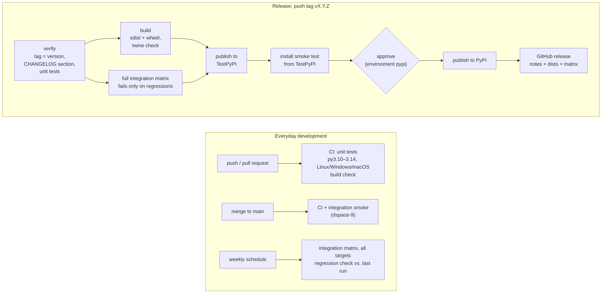

# Releasing the dspace-api-toolkit

The release process involves the following steps:



```bash
 push / PR -> CI: unit tests (py3.10-3.14, Linux/Windows/macOS), build check
 main      -> CI + integration smoke (dspace-9)
 weekly    -> integration matrix, all targets, regression check against last week
 tag vX.Y.Z ─> verify ─> build ─> full matrix ─> TestPyPI ─> install smoke ─> [approve] ─> PyPI ─> GitHub release
```

A release is started by pushing a version tag (`vX.Y.Z`). The workflow
[`release.yml`](.github/workflows/release.yml) manages the process: it
tests and builds the package, runs it against every DSpace version,
publishes it to TestPyPI and then to PyPI, and creates the GitHub release.
No API tokens are involved; PyPI trusts the workflow itself (Trusted
Publishing).

## Overview

| When | What runs | Workflow |
|---|---|---|
| Every push and pull request | Unit tests on Linux with Python 3.10–3.14, 
plus Windows (3.12) and macOS (3.13); 100% coverage required; build and install 
check of the wheel | `ci.yml` |
| Push to `main` | The above, plus an integration smoke test against one real 
DSpace (`dspace-9`) | `ci.yml` → `integration-matrix.yml` |
| Weekly (Monday 03:00 UTC) | Integration tests against all targets in 
`integration/targets.yml`, compared with the previous run to spot regressions | 
`integration-matrix.yml` |
| Tag `vX.Y.Z` pushed | The release pipeline below | `release.yml` |

If any step fails, the steps after it do not run. Nothing reaches PyPI
until the TestPyPI package has installed and imported cleanly **and** a
maintainer has approved the `pypi` deployment.

## One-time setup

Done once per repository; skip if it is already in place.

1. **Trusted Publishing on PyPI and TestPyPI.** On
   [pypi.org](https://pypi.org/manage/account/publishing/) and
   [test.pypi.org](https://test.pypi.org/manage/account/publishing/), add a
   (pending) publisher:

   | Field | PyPI | TestPyPI |
   |---|---|---|
   | Project name | `dspace-api-toolkit` | `dspace-api-toolkit` |
   | Owner | `sszepe` | `sszepe` |
   | Repository | `dspace-api-toolkit` | `dspace-api-toolkit` |
   | Workflow | `release.yml` | `release.yml` |
   | Environment | `pypi` | `testpypi` |

2. **GitHub environments.** Under *Settings → Environments*, create
   `testpypi` and `pypi`. On `pypi`, add yourself (or the maintainers) as
   **required reviewer** and limit deployments to tags matching `v*`.

## Making a release

### 1. Prepare the version

- `dspace_api/_version.py` holds the version (`__version__ = "0.7.0"`).
  It is the only place the version is stored; `pyproject.toml` reads it.
- `CHANGELOG.md` needs a section with exactly that version. Move the
  entries from `## [Unreleased]` into it and keep an empty
  `## [Unreleased]` at the bottom:

  ```markdown
  ## [0.1.0] - 2026-11-08

  ### Added
  - ...

  ## [Unreleased]
  ```

The release workflow refuses to continue if the tag, `_version.py` and the
changelog section do not match. The changelog section also becomes the text
of the GitHub release.

### 2. Merge into `main`

```bash
git commit -am "Release 0.1.0"
git push
gh pr create --base main --title "Release 0.1.0" --fill
gh pr checks --watch
gh pr merge --squash            # main requires linear history: squash or rebase
```

Afterwards, bring `dev` up to date with a pull request from `main` into `dev`.

### 3. Optional: run the full matrix before tagging

```bash
gh workflow run integration-matrix.yml --ref main
gh run watch
```

Release tags are protected and cannot be moved or deleted. If the matrix
fails after tagging, the fix needs a new version number. Running it first
finds problems while the version is still unused.

### 4. Tag and push

```bash
git checkout main && git pull
git tag -a v0.1.0 -m "dspace-api-toolkit 0.1.0"
git push origin v0.1.0
gh run watch
```

The run pauses at **pypi** and waits for approval: check the TestPyPI page
and the smoke step, then approve it under *Actions → the release run →
Review deployments*.

### 5. Check the result

- <https://pypi.org/project/dspace-api-toolkit/> shows the new version.
- The GitHub release has the changelog notes, the wheel and sdist, and the
  compatibility matrix (`matrix.html`, `matrix.json`).
- `pip install -U dspace-api-toolkit` in a fresh environment, then
  `python -c "import dspace_api; print(dspace_api.__version__)"`.

## Release candidates

To test the whole pipeline without using up a final version, release a
candidate first: set the version to `0.1.0rc1`, add a `## [0.1.0rc1]`
changelog section, and tag `v0.1.0rc1`. It is published to PyPI and GitHub
as a pre-release, which `pip install dspace-api-toolkit` ignores unless
`--pre` or the exact version is given.

## Version numbers

The project follows [Semantic Versioning](https://semver.org/):

- **Patch** (`0.1.1`): bug fixes only.
- **Minor** (`0.2.0`): new features, backwards compatible.
- **Major** (`1.0.0`): incompatible API changes. Before 1.0, minor versions
  may still contain breaking changes; list them in the changelog under
  `### Changed` or `### Removed`.

## If something goes wrong

| Problem | What to do |
|---|---|
| `verify` fails: tag does not match | Fix `_version.py` or the changelog on `main`, then tag the next version (tags cannot be moved). |
| Integration matrix fails | Failed tests alone do not fail it: they show up as "failed" in the matrix. The job fails only if a stack did not start, or a feature that passed in the last run on `main` now fails (regression). Open the matrix and the `report-<target>` artifacts (test report, container log), fix it, and release a new patch version. |
| TestPyPI upload rejected: version exists | Each version can be uploaded only once, even after deletion. Use the next version (or the next `rcN`). |
| Publishing fails with an OIDC / trusted publisher error | Compare the publisher settings on PyPI with the table above: workflow file name and environment name must match exactly. |
| A broken version 